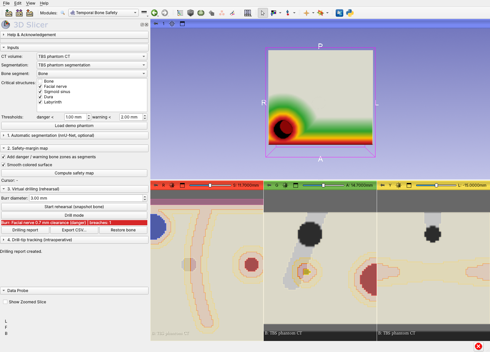
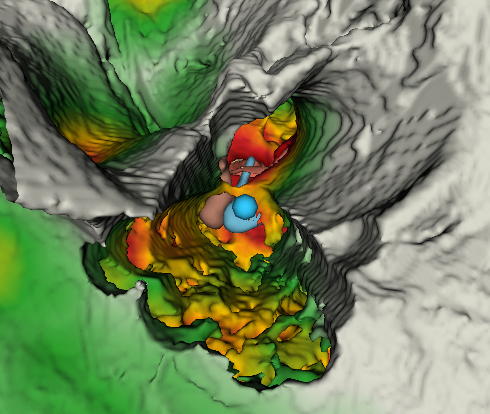

# Temporal Bone Safety (3D Slicer extension)

A 3D Slicer module for otologic drilling. It answers the surgeon's question
**"how far and how deep can I drill?"** by showing, as a number and a color,
how much bone is left between the drill and the facial nerve, sigmoid sinus,
dura and labyrinth.



*Research use only. Not a medical device.*

## What it does

| Section | Purpose |
|---|---|
| **1. Automatic segmentation** (optional) | Runs a trained nnU-Net v2 model on the CT and imports each label as a segment. |
| **2. Safety-margin map** | Distance maps to all checked critical structures; bone surface colored by clearance (dark red at 0 mm → red at danger → amber at warning → green → bone color); *danger* and *warning* bone zones added as segments for the 2D views; live readout of the nearest structure and distance under the mouse in any view. |
| **3. Virtual drilling** | A spherical burr ("Drill" point) removes bone from the patient's own segmentation as you drag it. A live label shows the clearance and counts breaches. **Drilling report**: removed volume, thinnest bone left over each structure, bone removed within 1 mm, breach events, drilling time, number of pauses ≥ 1 s, burr path length. Erasing with Segment Editor also counts. Reports export to CSV. |
| **4. Drill-tip tracking** | Follows a tool-tip transform (for example `DrillTipToRAS` from OpenIGTLink after pivot calibration in SlicerIGT). Shows a large color-coded distance readout with an optional beep, and can optionally remove virtual bone along the tool path. **Session report**: minimum distance, time in danger and warning zones, pauses, path length, plus a raw time-stamped log. |

The pause count and time-in-zone metrics are meant as outcome measures for
comparing drilling with and without guidance, and junior with senior surgeons.

## Install

1. Copy the folder `SlicerTemporalBoneSafety` anywhere.
2. In Slicer: *Edit → Application Settings → Modules → Additional module paths*
   → add `.../SlicerTemporalBoneSafety/TemporalBoneSafety` → restart.
3. The module appears under **Modules → IGT → Temporal Bone Safety**.

(Alternatively, drag `TemporalBoneSafety.py` onto the Slicer window and choose *Add Python scripted modules to the application*.)

Tested with Slicer 5.12.4 (Linux). No extra packages are needed; distances use SimpleITK, which ships with Slicer.

## Quick start (no data needed)

1. Click **Load demo phantom**. This loads a synthetic temporal-bone block with a facial nerve, sigmoid sinus, dura and labyrinth.
2. **Compute safety map**, then hover over the slice views to read the clearance.
3. **Start rehearsal**, then turn on **Drill mode** and drag the *Drill* point down into the bone.
4. **Drilling report** → **Export CSV…**; **Restore bone** to try again.

## Public data: OpenEar



The module was run on **OpenEar** specimen **ZETA**: a CBCT of a cadaveric right temporal bone with 13 expert segments. Data are CC BY 4.0, from Sieber et al., *Sci Data* 2019, and Zenodo record 1473724.

```
python TemporalBoneSafety/Testing/fetch_openear.py ZETA ./openear_ZETA      # ~290 MB, not the 3.9 GB zip
OPENEAR_DIR=./openear_ZETA TBS_OUT=./results OPENEAR_SPECIMEN=ZETA \
  Slicer --additional-module-paths <path>/TemporalBoneSafety \
         --python-script TemporalBoneSafety/Testing/openear_demo.py
```

The demo crops the CBCT to the middle and inner ear with a 15 mm margin (53 × 54 × 60 mm) and resamples it to 0.25 mm. The module then picks the critical structures by itself: scala tympani and vestibuli, the ossicles, the cochleovestibular nerve, facial nerve, chorda tympani, sinus/dura and carotid. Next comes a scripted mastoidectomy rehearsal:

* The entry point is chosen on the outer cortex. It is the straight path toward the antrum beside the incus that gets deepest without crossing the 1 mm danger line or entering the external auditory canal.
* A 4 mm burr drills from about 40 entry points around it, then a 2 mm burr drills along the main axis.
* Every stroke stops at the danger line.

Result on ZETA (`Testing/openear_demo.py`, about 5 min headless):

| Structure | Thinnest bone left | Zone |
|---|---|---|
| Incus | 1.02 mm | warning |
| Sinus/dura | 1.46 mm | warning |
| Malleus | 1.57 mm | warning |
| Chorda tympani | 1.61 mm | warning |
| Facial nerve | 5.52 mm | safe |
| Scala vestibuli | 4.90 mm | safe |
| Carotid | 16.7 mm | safe |

The rehearsal removed 979 mm³ of bone with 0 breaches. The drilling path is an automatic demonstration, not a surgical plan.

OpenEar segment names differ slightly between specimens: EPSILON uses "EAC" and "Sinus - Dura", ZETA uses "External Auditory Canal" and "Sinus Dura". The demo matches them either way. All eight specimens (ALPHA–THETA) can be fetched with the same command.

## With real data

* Crop the CT to the temporal bone first (*Crop Volume*); distance maps are computed on the full CT grid.
* Segment the bone and the critical structures yourself (Segment Editor) or with **1. Automatic segmentation**. The module pre-checks segments whose names contain nerve/sinus/dura/labyrinth/cochlea/carotid/ossicle terms, and picks the bone segment by name.
* Public data to start with: **OpenEar** (8 temporal bones, CBCT with facial nerve, chorda, ossicles, sinus/dura, carotid labels; Zenodo 1473724) and the **Human Inner Ear** labeled CT set (43 cadaveric flat-panel CTs; Zenodo 8277159).

### nnU-Net model

Train an nnU-Net v2 model in your own Python environment (for example on OpenEar plus your own cases), then point **Model folder** at the trained model folder, i.e. the one containing `dataset.json` and the `fold_*` folders. **Command** defaults to `nnUNetv2_predict_from_modelfolder`; give its full path if it lives outside Slicer's environment. Label names come from `dataset.json`.

## Tests

* Core math, outside Slicer: `pytest TemporalBoneSafety/Testing/test_core.py` (14 tests).
* In Slicer: the module's *Reload and Test* button, or
  `Slicer --no-splash --additional-module-paths <path>/TemporalBoneSafety --python-script TemporalBoneSafety/Testing/run_in_slicer.py`
  This runs the self-test and the full widget workflow on the phantom.

## Notes and limits

* "Thinnest bone left" is the distance from the drilled cavity to the structure surface. It is accurate to about half a voxel, so it is only as good as the segmentation.
* The tracking section assumes the transform already places the tool **tip** in the CT's coordinates. Registration and tool calibration are done elsewhere (SlicerIGT: Fiducial Registration Wizard, Pivot Calibration).
* The colored surface refreshes about 0.8 s after drilling stops.

## Layout

```
SlicerTemporalBoneSafety/
├── CMakeLists.txt                      # extension
├── Screenshots/screenshot.png
└── TemporalBoneSafety/
    ├── CMakeLists.txt                  # module
    ├── TemporalBoneSafety.py           # UI, Slicer logic, self-test
    ├── TemporalBoneSafetyLib/core.py   # numpy/SimpleITK math (no Slicer imports)
    ├── Resources/Icons/TemporalBoneSafety.png
    └── Testing/{test_core.py, run_in_slicer.py,
                 fetch_openear.py, openear_demo.py}
```
